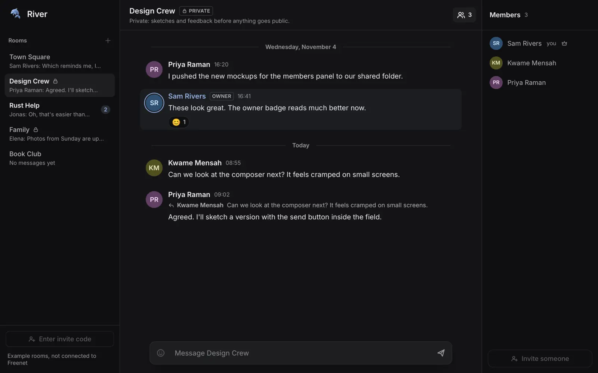
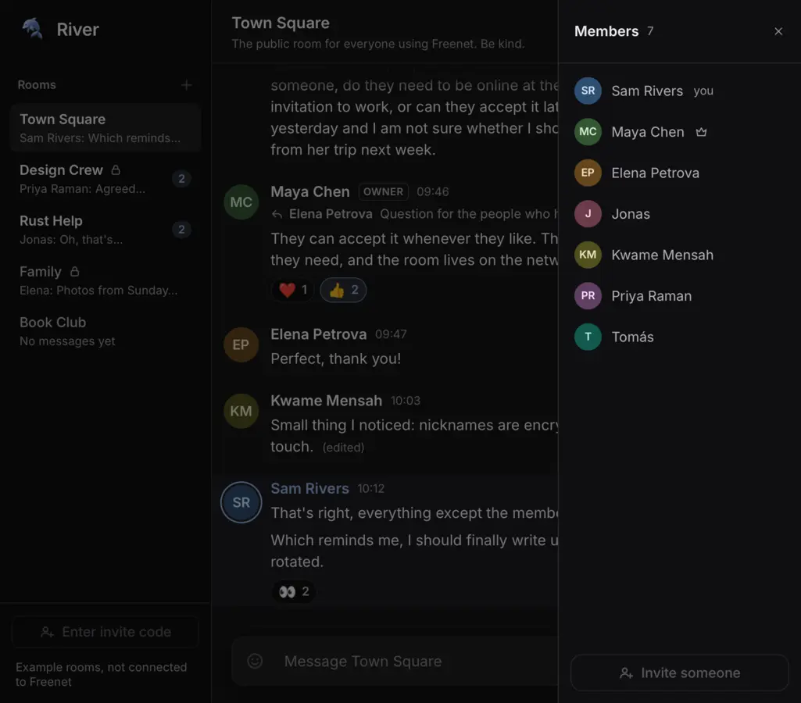
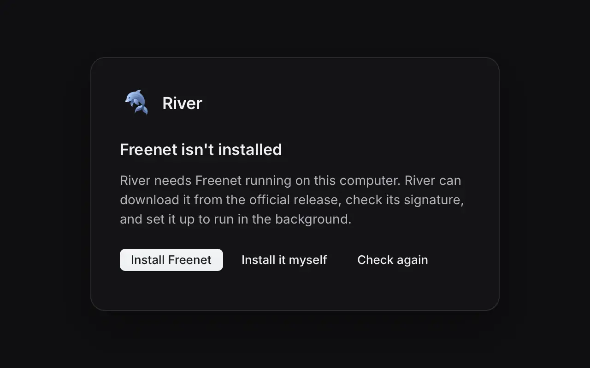
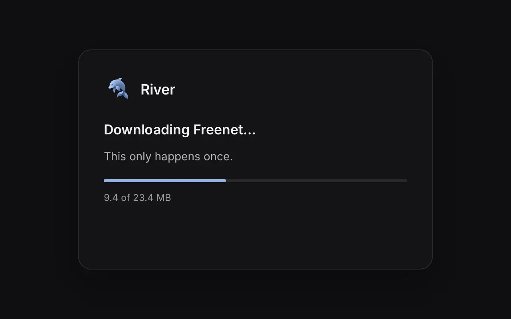

River, the group chat app built on Freenet, has until now run only in a web browser, served by a Freenet node on your own computer. That means you need Freenet installed and running before you can open River at all. We have started work on a native desktop app that removes that first step: you open River, and River makes sure Freenet is running.

This post is a preview. Two pieces of the app were merged into the [River repository](https://github.com/freenet/river) on 6 November 2026. The first gets the app connected to a Freenet node, installing Freenet if needed. The second is the chat screen, which **does not talk to Freenet yet**: it shows built-in example rooms, and the app says so. The screenshots below were rendered from the merged code.

## The chat screen

*The chat screen. The rooms, members and messages are example data built into the app. The footer under the room list reads "Example rooms, not connected to Freenet".*

The layout follows River's web interface: rooms on the left, the open room's conversation in the middle, and the room's members on the right. You can switch rooms, type and send a message, and show or hide the members panel. All of this happens in memory, on the example rooms. Each room keeps its own unsent draft.

Several controls are drawn but do nothing yet: creating a room, entering an invite code, inviting someone, and the emoji button. They are dimmed and say "Not available yet" when you hover over them. Reactions are shown but cannot be added or removed, and the message box is a single line for now.

*A private room, again on example data. Private rooms show a lock in the room list and a PRIVATE tag in the header.*

In a narrow window the room list gets narrower and the members panel is left out. Opening the members list then shows it over the conversation, which is dimmed until you close the panel.

*A narrow window with the members panel open, on example data.*

## Getting Freenet running

The first thing the app does is look for a Freenet node on your computer, by asking the node's local address (port 7509) for its version. What happens next depends on the answer:

- If a node answers and is recent enough, River connects to it.
- If no node answers but Freenet is installed, River starts it as a service, without asking, because River cannot work without it.
- If Freenet is not installed, River offers to install it.

*The setup screen River shows when Freenet is not installed.*

The installer downloads the latest Freenet release from the [freenet-core releases on GitHub](https://github.com/freenet/freenet-core/releases). Before it downloads Freenet itself, it checks the release's list of file checksums against Freenet's release signature, using the same ed25519 public key that `freenet update` uses. It then checks the downloaded file's SHA-256 against that signed list. A release without a signature is refused.

*The download step. This is a rendered test state, so the sizes shown are not from a real download.*

Each platform gets the package Freenet already ships for it:

- **Linux:** the `freenet` binary goes into `~/.local/bin`, and River registers it as a user service the first time it starts it.
- **macOS:** River copies Freenet.app from the signed disk image into Applications.
- **Windows:** River runs Freenet's signed installer, which opens its own setup wizard.

Here is how much of this we have tested. On Linux, we ran the download and verification against a real Freenet release, and the app connected to a running node. We did not register a new service on a real machine. The macOS and Windows install steps pass unit tests in our CI but have not yet been run on real Macs or Windows PCs.

## Why we chose Rune

The app is built with [Rune](https://github.com/anomalyco/rune), a Rust UI toolkit that draws everything with the GPU, with its own renderer, text handling and layout. It supports macOS, Windows and Linux.

Our first plan was to use GPUI, the UI framework from the Zed code editor. Ian Clarke, who started Freenet, suggested Rune instead. In his words: "another advantage of Rune is that it claims to have a more modern feel. pre-agent I'd be worried about it being so young but agents mean these things move fast now."

When we made the switch, we recorded these reasons for it:

- **It has the parts a chat app needs.** Rune comes with text fields, lists that only lay out the rows on screen, scrolling that stays at the bottom as new messages arrive, and accessibility support for screen readers through [AccessKit](https://accesskit.dev).
- **It can run without a window.** Every Rune app can render any screen to an image from the command line. Each River screen is defined as a named scene, and our CI renders every scene on each change to the app. That is also how the screenshots in this post were made.
- **Tests can drive the real interface.** Our tests render the actual UI without a window and then press buttons, type into the message box, press Return and Tab, and resize the window, then check what is on screen.
- **One UI, thin platform shells.** The app is split in two. `apps/river-app` holds the interface and the setup logic, and works on any platform. `apps/desktop` is the desktop shell, which finds, installs and starts Freenet on each operating system. A shell for another platform could reuse the same interface later. We have not committed to one.

Rune also has costs:

- **It is young.** Rune is pre-release and is not published on crates.io. We pin one exact git revision and update it on purpose, re-rendering every screen when we do.
- **It needs a newer Rust compiler** than the rest of the River repository uses, so the app has its own toolchain setting.
- **Some things take extra work.** Rune's built-in icons are drawn in a single colour, so River's multi-colour logo is instead rasterized from the web interface's SVG file when the app starts.

## Keeping your rooms safe

River's room contract and chat delegate (the code that stores your rooms and keys on your own node) are identified on Freenet by a hash of their compiled WebAssembly. If that code changes even slightly, its address changes, and stored data has to be migrated to the new address.

The native app pulls in many new dependencies, such as graphics and windowing libraries. To make sure none of them can ever change River's contract or delegate code, the app lives in its own Cargo workspace under `apps/`, with its own lockfile. Updating the app's dependencies cannot change the code your rooms are stored with.

## What comes next

These steps are planned or in review, and none of them has shipped:

- **Your existing rooms in the app.** The native app will use the same chat delegate as River in the browser, so rooms you already have there will appear in the app. The first time the app connects, Freenet will open your browser at a page served by your own node, where you approve the app. Your node records that approval, and you can revoke it from the node's dashboard. This is [freenet-core#6130](https://github.com/freenet/freenet-core/pull/6130), which is still in review.
- **Real rooms on the chat screen.** After that, the code that talks to the node moves into `river-core`, River's shared library, so the chat screen can show your real rooms in place of the example data.

There is no download of the native app yet. If you want to look at the code, it is in the `apps/` directory of the [River repository](https://github.com/freenet/river).
